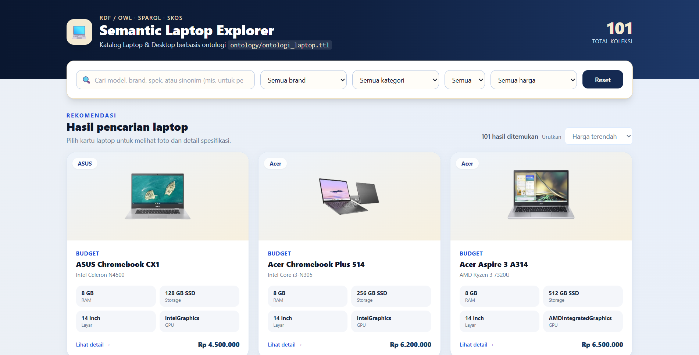

# Semantic Laptop — Sistem Rekomendasi & Pencarian Spesifikasi Laptop Berbasis Ontologi

Aplikasi desktop dan web terintegrasi berbasis Java (Maven) dan Web Semantik untuk pencarian serta rekomendasi spesifikasi laptop menggunakan ontologi OWL/Turtle (`ontologi_laptop.ttl`) dan kueri SPARQL.

## Fitur Utama

* **Pencarian Semantik & Intent Detection:** Menganalisis maksud kueri pengguna (`QueryIntent`) serta pemahaman sinonim berbasis SKOS, lalu memberikan skor relevansi pada setiap kandidat laptop (`ScoredLaptop`).
* **Basis Pengetahuan Ontologi:** Menggunakan file ontologi Turtle (`ontologi_laptop.ttl`) yang memuat koleksi perangkat laptop & desktop berbasis RDF/OWL, SPARQL, serta kompatibel dengan Protégé.
* **Antarmuka Hybrid (Desktop & Web):** Dilengkapi tampilan desktop Java Swing (`LaptopFrame`) sekaligus antarmuka web modern **Semantic Laptop Explorer** (`index.html`, `style.css`, `app.js`) yang disajikan melalui controller internal.
* **Filter Multi-Kriteria & Pengurutan Instan:** Mendukung penyaringan kombinasi berdasarkan merek, kategori segmen, kapasitas RAM, rentang harga, serta pengurutan hasil secara dinamis.
* **Konfigurasi Port Dinamis:** Mendeteksi dan mengatur port server secara otomatis (`DynamicPortConfig`) untuk mencegah bentrok port saat dijalankan.

## Antarmuka Pengguna (Semantic Laptop Explorer)



Aplikasi ini menghadirkan antarmuka **Semantic Laptop Explorer** yang terhubung langsung dengan basis pengetahuan ontologi `ontology/ontologi_laptop.ttl` (memuat **101 total koleksi** perangkat laptop & desktop berbasis RDF/OWL, SPARQL, dan SKOS).

### 1. Pencarian Semantik & Sinonim (Search Bar)
Pengguna dapat mengetikkan kata kunci bebas pada kolom pencarian (*"Cari model, brand, spek, atau sinonim..."*) untuk menemukan perangkat secara cerdas:
* **Pencarian Spesifikasi & Model:** Mendukung pencarian langsung berdasarkan nama seri/model laptop, merek, prosesor, kapasitas RAM, penyimpanan, hingga jenis GPU.
* **Pemahaman Sinonim & Kebutuhan (SKOS & Query Intent):** Memanfaatkan relasi semantik pada ontologi sehingga pengguna dapat mencari berdasarkan konteks penggunaan atau istilah sinonim (misalnya kebutuhan *gaming*, *editing*, *kuliah*, atau *budget*) tanpa harus menghafal kode seri perangkat.

### 2. Filter Multi-Kriteria & Pengurutan
Untuk mempersempit hasil eksplorasi secara instan, tersedia bilah filter kombinasi dan kontrol pengurutan:
* **Filter Brand (`Semua brand`):** Menyaring katalog berdasarkan produsen perangkat tertentu (seperti ASUS, Acer, dll.).
* **Filter Kategori (`Semua kategori`):** Mengelompokkan perangkat berdasarkan segmen kelasnya (seperti *Budget*, *Gaming*, *Ultrabook*, dsb.).
* **Filter Kapasitas RAM (`Semua RAM`):** Memilih perangkat berdasarkan ukuran memori utama yang dibutuhkan.
* **Filter Rentang Harga (`Semua harga`):** Membatasi hasil pencarian sesuai anggaran belanja pengguna.
* **Tombol Reset:** Mengembalikan seluruh parameter pencarian dan filter ke kondisi awal dalam satu klik.
* **Pengurutan Hasil (`Urutkan`):** Mengatur urutan tampilan katalog, seperti berdasarkan **Harga terendah** maupun kriteria pengurutan lainnya.

### 3. Kartu Katalog & Tampilan Detail
Setiap hasil pencarian ditampilkan dalam bentuk kartu ringkas yang memuat visual foto produk, label merek, kategori segmen, nama model, prosesor, ringkasan spesifikasi inti (RAM, Storage, Layar, GPU), serta harga dalam Rupiah. Pengguna dapat mengklik **`Lihat detail ->`** pada kartu mana pun untuk membuka informasi spesifikasi lengkap beserta foto resmi model perangkat tersebut.

## Teknologi yang Digunakan

* **Backend & Desktop:** Java (Maven), Java Swing, Apache Jena (RDF/OWL, SKOS & SPARQL Engine)
* **Frontend (Embedded Web UI):** HTML5, CSS3, Vanilla JavaScript
* **Ontology & Knowledge Base:** Turtle (`.ttl`), Protégé, SPARQL

## Struktur Proyek

```text
semantic-laptop/
├── docs/
│   ├── PROTEGE-QUICKSTART.md          # Panduan cepat membuka ontologi di Protégé
│   ├── SEMANTIC-SEARCH-IMPROVEMENTS.md# Catatan pengembangan algoritma pencarian
│   └── SPARQL-queries.rq              # Kumpulan kueri SPARQL referensi
├── src/
│   └── main/
│       ├── java/id/ac/semanticlaptop/
│       │   ├── Main.java              # Entry point utama aplikasi
│       │   ├── LaptopFrame.java       # Antarmuka GUI Desktop
│       │   ├── LaptopController.java  # REST/Web Controller untuk UI Web
│       │   ├── LaptopRepository.java  # Logika pemrosesan ontologi, SPARQL & scoring
│       │   ├── Laptop.java            # Model entitas Laptop
│       │   └── DynamicPortConfig.java # Konfigurasi port otomatis
│       └── resources/
│           ├── application.properties # Konfigurasi aplikasi
│           ├── ontology/
│           │   ├── ontologi_laptop.ttl# File basis pengetahuan ontologi laptop
│           │   └── catalog-v001.xml   # Katalog URI ontologi Protégé
│           └── static/
│               ├── images/            # Aset foto visual produk laptop (PNG)
│               ├── index.html         # Halaman utama antarmuka web
│               ├── css/style.css      # Stylesheet antarmuka web
│               └── js/app.js          # Logika interaktif frontend
├── target/
│   └── semantic-laptop-desktop-1.0.0.jar # Executable JAR hasil build
└── pom.xml                            # Konfigurasi dependensi Maven
```

## Prasyarat

* **Java Development Kit (JDK):** Versi 11 atau lebih baru (disarankan JDK 17+)
* **Apache Maven:** Versi 3.6+ (opsional jika menjalankan langsung file `.jar`)
* **Protégé** *(Opsional)*: Jika ingin melihat atau memodifikasi file `ontologi_laptop.ttl` secara visual.

## Cara Menjalankan Aplikasi

### Opsi 1: Menjalankan Langsung File JAR (Tercepat)
Pastikan proyek sudah di-build, lalu jalankan file executable JAR yang tersedia di folder `target/`:

```bash
java -jar target/semantic-laptop-desktop-1.0.0.jar
```

### Opsi 2: Build dan Jalankan dari Source Code (Maven)
1. Masuk ke direktori utama proyek:
   ```bash
   cd semantic-laptop
   ```
2. Lakukan kompilasi dan packaging menggunakan Maven:
   ```bash
   mvn clean package
   ```
3. Jalankan aplikasi:
   ```bash
   mvn spring-boot:run
   ```
